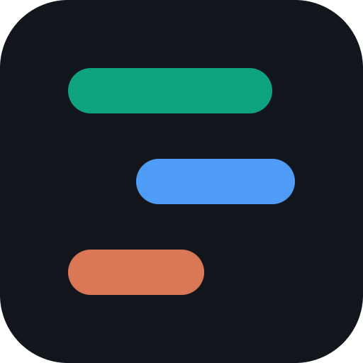
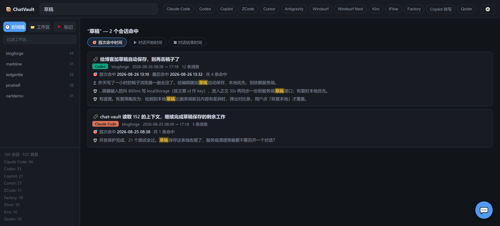
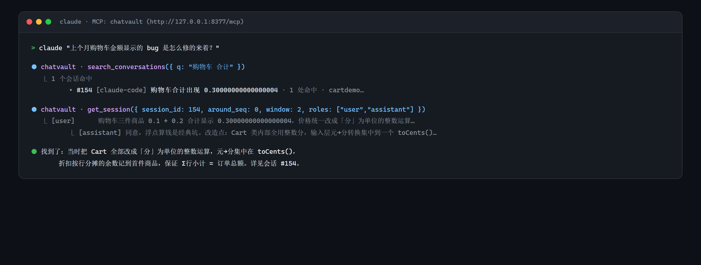

# ChatVault · 薪传

**给人看的对话档案，给 Agent 用的共享上下文。**

ChatVault 将散落在不同 AI 编程工具中的会话同步到本地 SQLite。你可以在浏览器里搜索、阅读和整理；Agent 可以通过 MCP 检索同一份记录、读取原文、接续工作。

例如：昨天用 Claude Code 排查的问题，今天换到 Codex，只需告诉它：

> 请用 ChatVault 搜索这个项目的历史，读取最近的相关会话，核对当前代码后继续处理未完成项。

## 人和 Agent，读同一份记录

| 使用者 | 入口 | 可以做什么 |
|---|---|---|
| 人 | 本地 Web UI | 全文搜索、按项目浏览、阅读消息与图片、收藏、标记、查看会话关联 |
| Agent | HTTP MCP | 搜索历史、分页读取原文、追踪接续链、查看任务快照和收藏 |
| 脚本 | CLI / HTTP API | 增量同步、搜索、统计、备份与恢复 |

- **跨工具接续**：保留消息角色、时间、工具记录和来源，减少手动复制上下文。
- **本地优先**：默认监听 `127.0.0.1`，归档同步只读源文件，不修改原始会话。
- **持续同步**：运行 `serve` 后自动扫描并监听变化，按指纹增量入库。
- **无需数据库服务**：Node.js 自带 SQLite；从源码运行无需 `npm install` 或前端构建。
- **可选功能**：ChatGPT 浏览器同步、自然语言问库、Pi 会话面板、加密增量备份。



## 三步启动

需要 **Node.js 22.19 或更新版本**，支持 Windows、macOS 和 Linux。

### 1. 安装并运行

推荐从 GitHub Release 安装：

```sh
npm install -g https://github.com/puppywang/chat-vault/releases/latest/download/chat-vault.tgz
chat-vault serve --port 8377
```

或直接运行源码：

```sh
git clone https://github.com/puppywang/chat-vault.git
cd chat-vault
node bin/chat-vault.js serve --port 8377
```

### 2. 打开浏览器

访问 **http://127.0.0.1:8377**。首次启动会扫描本机支持的会话目录；之后保持服务运行即可。数据量较大时，首次同步需要一些时间。

### 3. 给 Agent 接入 MCP（可选）

在客户端的 MCP 配置中添加 HTTP 服务；不同客户端的字段名称可能不同：

```json
{
  "mcpServers": {
    "chatvault": {
      "type": "http",
      "url": "http://127.0.0.1:8377/mcp"
    }
  }
}
```

然后可以直接说：

> 请用 ChatVault 读取 42 号会话及其接续链，总结已完成和未完成项，再核对当前项目继续工作。

MCP 是档案的读取入口；执行后续任务仍由你的 Agent 及其权限控制。

## Agent 如何读取

建议先搜索，再读取相关上下文，避免一次装入整份长会话：

```text
search_conversations({"q":"缓存失效"})
get_session({"session_id":42,"around_seq":80,"window":10})
get_session_chain({"session_id":42,"direction":"both"})
```

| 工具 | 用途 |
|---|---|
| `search_conversations` | 全文搜索，返回会话 ID、消息位置和摘要 |
| `get_session` | 读取会话原文；支持分页、角色过滤和命中位置上下文 |
| `list_sessions` / `list_workspaces` | 浏览会话与项目 |
| `get_session_chain` | 追踪跨 Agent 的引用和接续关系 |
| `list_task_states` / `list_flagged` | 查看历史任务快照、收藏和标记 |
| `get_stats` | 查看归档规模与来源分布 |

支持 MCP prompts 的客户端还可以使用 `here`（当前项目历史）和 `resume`（会话交接）。历史记录用于定位和核对，当前代码、实际运行状态及用户最新要求决定下一步。



## 支持的来源

Claude Code、Codex、Copilot、Cursor、Antigravity、Windsurf、Windsurf Next、Kiro、iFlow、Factory、Qoder、ZCode、DeepSeek Harness、WorkBuddy、Pi、ChatGPT、Codex Cloud、OpenCode，以及 Copilot 转写日志。

本地会话通常可以自动发现。**ChatGPT 网页会话需要主动导入**：

- **日常同步**：加载 [ChatGPT Sync Chrome 扩展](extensions/chatgpt-sync/README.md)，浏览对话时同步到本机 ChatVault。Release 同时提供扩展 ZIP，解压后在 `chrome://extensions` 开启开发者模式并加载。
- **导入历史**：将 ChatGPT 官方导出的整个目录放到 `~/.chat-vault/imports/chatgpt/`。保留附件目录，避免丢失图片。

同一会话按来源标识去重。网页与 Pi 等执行侧会话可以手动关联，合并阅读时保留各自来源。Codex Guardian 自动审批记录默认隐藏，普通任务子 Agent 仍正常显示。

## 常用命令

```sh
chat-vault sync                   # 增量同步一次
chat-vault search "缓存失效"       # 搜索历史
chat-vault stats                  # 查看统计
chat-vault serve --port 8377      # Web UI + MCP + 自动同步
chat-vault backup --dry-run       # 生成本地备份快照并自检
chat-vault backup --push          # 推送至已配置的备份端
chat-vault backup --status        # 查看备份状态
```

源码安装时，将命令前缀 `chat-vault` 换成 `node bin/chat-vault.js`。完整参数见 `chat-vault --help`。

## 部署与数据

- **个人电脑常驻**：将上述启动命令交给本机已有的服务管理方式。Windows 也提供 `scripts/install-autostart.ps1`；详细步骤见 [部署指南](docs/DEPLOYMENT.md)。
- **远程机器**：默认扫描运行服务那台机器的会话目录。需要读取本机档案时可通过 SSH 转发访问，不必开放公网端口。
- **数据目录**：默认 `~/.chat-vault/`，包含 `chat-vault.db`、`images/`、`imports/`、`config.json` 和日志。旧 `~/.agent-exporter/` 目录可自动迁移。
- **备份**：可选 restic 加密去重上传，或 SSH/rsync 数据库快照；配置、密钥及恢复步骤见 [备份指南](docs/BACKUP-DESIGN.md)。
- **自然语言问库**：在设置中配置 OpenAI 兼容模型。启用后，相关检索结果会发送给你选定的模型服务；普通搜索和 MCP 读取无需额外模型配置。

默认配置适合单机使用。对话可能含源码、凭据及个人信息；启用局域网访问前，应自行配置可信网络和访问控制。主动从页面发起 Agent 续作会执行任务，和只读浏览、MCP 查询是不同功能。

## 开发与文档

| 文档 | 读者与内容 |
|---|---|
| [部署指南](docs/DEPLOYMENT.md) | 首次安装、常驻运行、升级、跨机器访问和排障 |
| [AGENTS.md](AGENTS.md) | Agent 开发入口、代码结构和验证约定 |
| [适配器接入指南](docs/AGENT-INTEGRATION-GUIDE.md) | 为新的 AI 工具增加会话解析 |
| [备份与恢复](docs/BACKUP-DESIGN.md) | 快照、restic、远端接收端与恢复 |
| [ChatGPT Sync](extensions/chatgpt-sync/README.md) | 浏览器扩展安装与功能说明 |
| [Agent 运行控制](docs/RUNTIME.md) | 从页面主动续作、附件与本机权限边界 |

```sh
node --test test/*.test.js
npm run verify:chatgpt
```

截图来自 `scripts/make-demo-db.js` 的虚构项目和对话。MIT License。
